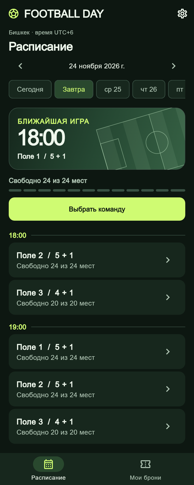

<p align="center">
  
</p>
<h1 align="center">⚽ Football Day</h1>
<p align="center"><strong>Любительский футбол в Бишкеке. Каждый вечер.</strong></p>
<p align="center">Выбери поле, собери друзей и займи места в одной команде.</p>
<p align="center">
  <a href="#-быстрый-запуск">🚀 Запуск</a> ·
  <a href="#-как-играть">🏟️ Как играть</a> ·
  <a href="#-документация">📚 Документация</a>
</p>

## 🏟️ Как играть

1. **Найди игру.** Каждый день в **18:00 и 19:00 по Бишкеку** доступны три поля. На табло видно, сколько мест свободно.
2. **Выбери команду.** На каждом поле четыре команды. На полях 1–2 формат **5 + 1**, на поле 3 — **4 + 1**.
3. **Забронируй места.** Можно записаться одному или добавить друзей в свою команду. Позиция по желанию: вратарь, защитник, полузащитник, нападающий или **«Без разницы»**.
4. **Загляни в «Мои брони».** До начала игры можно поменять число мест, имена и позиции или отменить запись.

**🌙 Ночная арена** — крупное табло, анимированная полоса мест и отдельная страница брони с билетом после подтверждения.

<p align="center">
  
</p>

## 🚀 Быстрый запуск

- **🎮 Демо на Windows.** В подготовленной сборке запусти Android-эмулятор и открой [Start Football Day Demo.cmd](Start%20Football%20Day%20Demo.cmd). В приложении выбери **«Войти как демо-игрок»**. Демо использует локальный Firebase.
- **🔑 Google-вход.** В настроенной Android-сборке открой [Start Football Day Google.cmd](Start%20Football%20Day%20Google.cmd). Для записи с позициями нужны актуальные правила Firestore.
- **iPhone.** Сборка на Mac идёт через Swift Package Manager. Для запуска на своём iPhone следуй [инструкции для macOS](prompts/SETUP_AND_TESTING.md#сборка-и-запуск-на-iphone).
- **🛠️ Запуск из исходников.** Настрой Android SDK и Firebase по [инструкции](prompts/SETUP_AND_TESTING.md), затем выполни команды из корня проекта:

```powershell
cd frontend
if (-not (Test-Path .env)) { Copy-Item .env.example .env }
flutter pub get
flutter gen-l10n
flutter run
```

## 🧩 Под капотом

**Flutter · Dart · BLoC · GetIt · go_router · Firebase Auth · Cloud Firestore**

Расписание доступно гостям. Firestore обновляет состав в реальном времени и проверяет вместимость при каждой записи. Поля и тарифы демонстрационные, цена указана для справки. Интерфейс поддерживает русский и английский языки.

Мобильное приложение находится в [frontend](frontend), прежний Django API — в [backend](backend). Бронирование работает напрямую через Firestore.

## ✅ Проверки

```powershell
cd frontend
flutter analyze
flutter test
cd rules-tests
npm ci
npm test
```

Для правил Firestore нужны Node.js и Java 21+. Проверки выполняются в отдельном локальном проекте `demo-football-day`.

## 📚 Документация

- [🚀 Настройка и тестирование](prompts/SETUP_AND_TESTING.md)
- [🎨 Дизайн и анимации](prompts/UI_STYLE_GUIDE.md)
- [📋 Возможности и правила бронирования](prompts/FEATURES_AND_RULES.md)
- [🏗️ Архитектура и данные](prompts/ARCHITECTURE.md)
- [📖 Все документы проекта](prompts/README.md)
